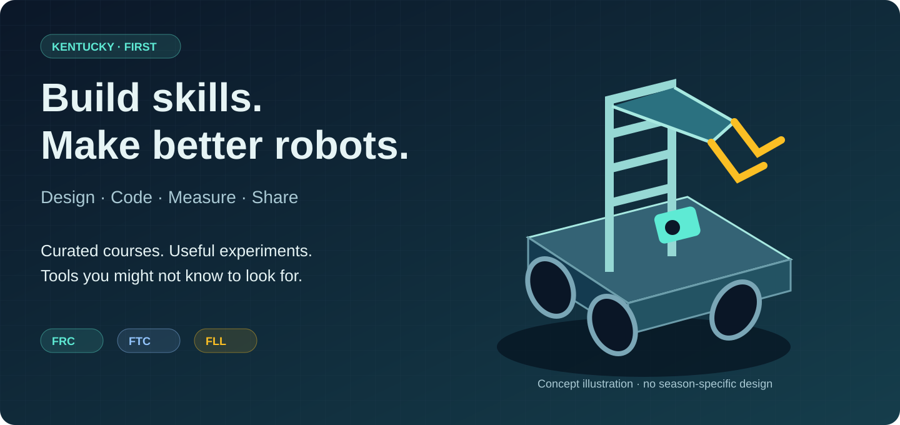

# KY FIRST Resource Hub

<figure><figcaption>
Concept robot illustration. Build skills. Make better robots. Design, code, measure and share.
</figcaption></figure>

**A robotics education hub for Kentucky students, mentors, and coaches.** Start with a proven course, then use the field notes and small experiments here to turn learning into team capability.

Looking for a specific website? [Browse the external link directories](resource-library/#external-link-directories).

## What are you working on?

<table data-view="cards"><thead><tr><th></th><th></th><th></th></tr></thead><tbody><tr><td><i class="fa-compass">:compass:</i></td><td><h3><a href="start-here/">Join a team</a></h3></td><td>Choose an FRC, FTC or FLL learning path and a first contribution.</td></tr><tr><td><i class="fa-book-open">:book-open:</i></td><td><h3><a href="resource-library/">Find a great resource</a></h3></td><td>A selective library of courses, technical references and local support.</td></tr><tr><td><i class="fa-screwdriver-wrench">:screwdriver-wrench:</i></td><td><h3><a href="tools-workflows/">Solve a harder problem</a></h3></td><td>CAD MCPs, Codex, telemetry, replay and simulation.</td></tr><tr><td><i class="fa-video">:video:</i></td><td><h3><a href="resource-library/watch-and-learn.md">Watch with a purpose</a></h3></td><td>Verified videos paired with a question and a next action.</td></tr><tr><td><i class="fa-users">:users:</i></td><td><h3><a href="team-operations/">Run a stronger team</a></h3></td><td>Outreach, sponsorship, onboarding and knowledge transfer.</td></tr><tr><td><i class="fa-map-pin">:map-pin:</i></td><td><h3><a href="resource-library/kentucky-teams-season.md">Connect in Kentucky</a></h3></td><td>Program partners, local events and funding source pages.</td></tr></tbody></table>

## Choose your program



**New programmer:** [WPILib Zero to Robot](https://docs.wpilib.org/en/stable/docs/zero-to-robot/introduction.html). **New designer:** [FRCDesign course](https://frcdesign.org/learning-course/).

Already building? [Investigate a failure with logs](tools-workflows/debug-with-logs.md) or [practice autonomous behavior without a robot](tools-workflows/practice-without-robot.md).



**First setup:** [FTC Docs](https://ftc-docs.firstinspires.org/en/latest/). **Design tradeoffs:** [Game Manual 0](https://gm0.org/en/latest/).

Use [the FTC path](resource-library/ftc-build-code.md) to move from a supported sample to telemetry, simulation and autonomous tooling.



**Coaches:** begin with [FIRST LEGO League](https://www.firstinspires.org/programs/fll/get-started) and current challenge materials. **Students:** choose a [SPIKE Prime lesson](https://education.lego.com/en-us/start/spike-prime/) and test one behavior repeatedly.

Our [FLL collection](resource-library/fll-lego-learning.md) includes a sensor-learning progression and a student-owned research activity.



Build a useful experience with a community partner. Start with [the curated outreach and funding collection](resource-library/outreach-sponsors-grants.md), then use [the event planning brief](team-operations/outreach.md) to define access, activity and evidence.



## Three discoveries worth your time

<table data-view="cards"><thead><tr><th></th><th></th><th></th></tr></thead><tbody><tr><td><i class="fa-plug">:plug:</i></td><td><h3><a href="tools-workflows/mcp-for-beginners.md">CAD connected to an assistant</a></h3></td><td>Fusion local MCP versus Onshape FeatureScript: choose the right scope.</td></tr><tr><td><i class="fa-chart-line">:chart-line:</i></td><td><h3><a href="tools-workflows/debug-with-logs.md">Your robot already tells a story</a></h3></td><td>Inspect commands, sensors and outputs together before changing code.</td></tr><tr><td><i class="fa-terminal">:terminal:</i></td><td><h3><a href="tools-workflows/codex-for-robotics.md">A coding agent with a real project</a></h3></td><td>Use Codex to explain a repository and make one reviewed change.</td></tr></tbody></table>


**Rules and safety:** use current official FIRST materials and your program's inspection guidance. This independent community hub curates learning resources; it does not issue competition rulings.


## Help keep the collection useful

[Suggest a resource or correction](contribute.md). Tell us who it helps, what problem it solves, and what you tested. We credit creators, label older material, and favor resources that teach something a generic search would miss.

_Last editorial review: November 17, 2026. Follow current publisher documentation for software and season changes._
