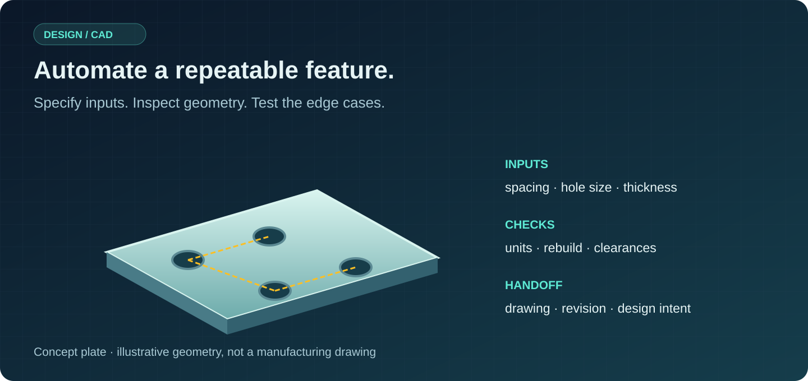

# CAD & design

## Recommended CAD courses and lesser-known tools

* [**CAD & mechanical design**](../resource-library/cad-mechanical-design.md) — FRCDesign, Onshape courses, part libraries, and videos.
* [**Fusion MCP: local CAD assistant**](../tools-workflows/fusion-mcp.md) — connect a running Fusion session to a compatible AI client.
* [**Onshape FeatureScript MCP**](../tools-workflows/onshape-mcp.md) — use an assistant to develop reusable parametric CAD features.

Start with a structured course; use the exercises below as checks on understanding.

***

A CAD model is not finished when it looks right. It is finished when teammates understand what it does, how it mounts, what it costs, and how it can be built.

## Start with the design question

Before opening a CAD tool, write down the part's purpose, interfaces, material assumptions, and critical dimensions. Design against constraints, not aesthetics.



### Define

List the function, required loads, constraints, safety factors, and which parts already exist in your team's ecosystem.



### Model

Create dimensioned sketches and simple features. Name major components and avoid fragile references.



### Review

Check assembly fit, tool access, fasteners, interference, manufacturing tolerances, and serviceability.



### Prototype and revise

Make the simplest viable prototype, measure its performance, then update the CAD and document what changed.



## Skill-building projects

* [Your first CAD part](first-cad-part.md)
* [Design review checklist](design-review.md)
* [From model to prototype](prototyping.md)

## Learn with

[Onshape Learning Center](https://learn.onshape.com/) provides guided CAD training; [Onshape Help](https://cad.onshape.com/help/) documents the tool. Teams may also use other CAD packages — the engineering principles here are tool-independent.


**Make decisions visible.** A short design note explaining _why_ you chose a geometry is more useful to next year's team than an unlabeled model.


## See it, then make it

<figure><figcaption>
Concept mounting plate with inputs and review checks.
</figcaption></figure>

### Onshape’s sketch geometry introduction

Official English lesson. Pair it with the FRCDesign course rather than learning only from isolated clips.



[Watch at YouTube](https://www.youtube.com/watch?v=xvn9hD7KMVs) · **Use it:** Produce one intentional sketch and explain its constraints.

_Editorial review: November 17, 2026._
