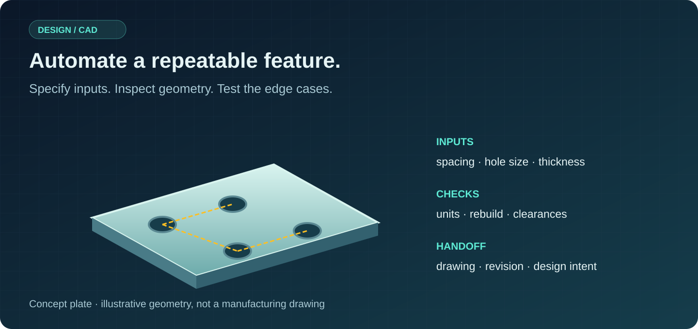

# Your first CAD part

**Project:** design a simple mounting plate that a teammate could manufacture.

## Requirements to define

* Overall envelope and material thickness.
* Number and location of mounting holes.
* Bolt/fastener sizes and clearance.
* Whether edges need chamfers, fillets, or deburring.
* Which dimensions are critical and which are flexible.



### Sketch and constrain

Create a planar sketch with intentional dimensions and constraints. Avoid accidental under-constrained geometry.



### Create the solid

Extrude to the intended thickness. Add holes and features with named dimensions.



### Generate a drawing

Provide at least orthographic views, units, dimensions, and a material note.



### Check manufacturability

Confirm how the part will be cut, drilled, inspected, and attached. Ask the person making it to review it.



## Submission checklist

* [ ] All required mounting interfaces are dimensioned
* [ ] Part material and thickness documented
* [ ] No obvious interference in assembly
* [ ] Revision label and short design rationale included
* [ ] Reviewer can manufacture from the drawing

Learn the tools through [Onshape Learning Center](https://learn.onshape.com/).

## Follow a proven lesson

Use [FRCDesign’s course](https://frcdesign.org/learning-course/) for the robotics modeling workflow and [Onshape Intro to CAD](https://learn.onshape.com/learning-paths/intro-to-cad) for guided tool practice.

 **Handoff test:** give the drawing to someone who did not model the part. Ask them to identify hole sizes, locations, units, stock and the revision. Record any question they cannot answer.

_Editorial review: November 17, 2026._
