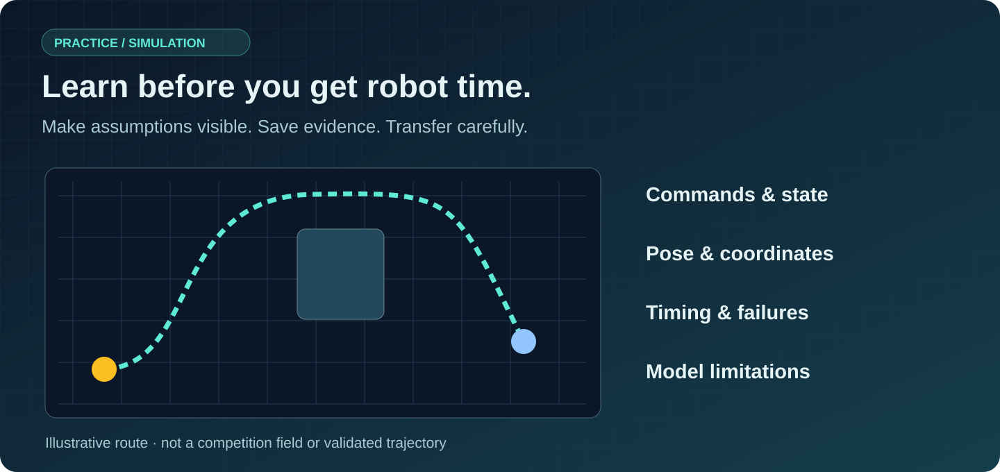

# Programming

## Best external starting points

* [**FRC software & controls**](../resource-library/frc-software-controls.md) — WPILib, simulation, PathPlanner, PhotonVision, and organized courses.
* [**FTC build & code**](../resource-library/ftc-build-code.md) — official SDK, Game Manual 0, and recorded introductions.
* [**Codex for robotics code**](../tools-workflows/codex-for-robotics.md) — using an AI coding agent with review and tests.
* [**Underused robotics tools**](../tools-workflows/underused-robotics-tools.md) — logging, replay, dashboards, and characterization.

The rest of this page is a short orientation, not a replacement for those lessons.

***

Good robot software is understandable under pressure. It separates responsibilities, handles failure safely, and can be tested before the next match.

## Choose your environment



Start with the [WPILib documentation](https://docs.wpilib.org/en/stable/) and its [Zero to Robot](https://docs.wpilib.org/en/stable/docs/zero-to-robot/introduction.html) pathway. Learn project structure, motor control, input devices, and Command-Based programming before adding advanced autonomy.



Use the official [FTC Docs](https://ftc-docs.firstinspires.org/) for supported programming environments, robot configuration, hardware mapping, and SDK practices. Follow your season's SDK guidance when updating dependencies.



Version control, debugging, code review, and reproducible testing transfer between programs. Practice on a small project, explain your design decisions, and keep a change log.



## Recommended sequence

1. **Control:** map one driver input to one predictable action.
2. **Feedback:** read a sensor and display its value.
3. **Structure:** separate hardware interfaces from robot behavior.
4. **Automation:** implement and test a simple state-driven task.
5. **Reliability:** add logging, edge cases, and a recovery plan.


**Testable goal:** another student should be able to build the project, run the same test, and get the same result using only your instructions.


## Practice guides

* [First robot program](first-robot-program.md)
* [Git and code review](git-and-code-review.md)
* [Autonomous planning](autonomous-planning.md)

## Reference material

* [WPILib](https://docs.wpilib.org/en/stable/)
* [FTC Docs](https://ftc-docs.firstinspires.org/)
* [GitHub pull requests](https://docs.github.com/en/pull-requests)
* [PhotonVision documentation](https://docs.photonvision.org/en/latest/) — check compatibility with your robot environment before adopting.

## Practice away from hardware

 [Choose a simulation exercise](../tools-workflows/practice-without-robot.md) and [inspect its evidence](../tools-workflows/debug-with-logs.md). The goal is a reproducible experiment, not just a moving animation.

_Editorial review: November 17, 2026._
