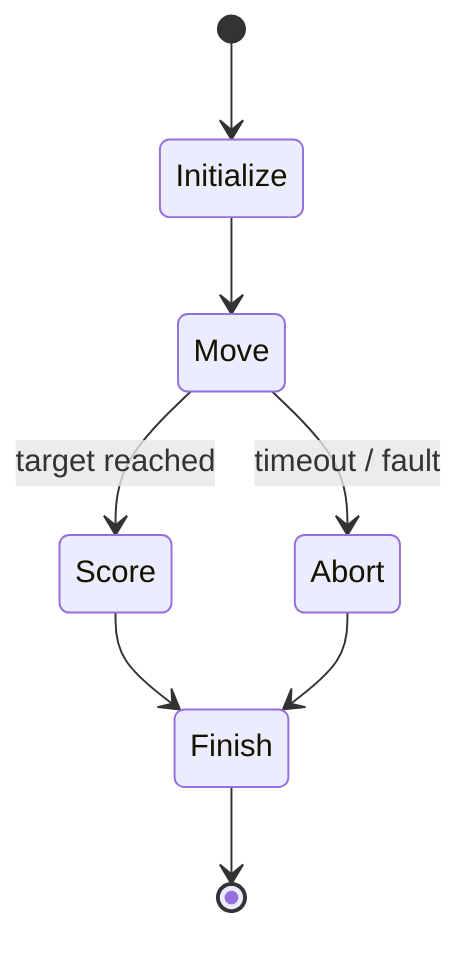
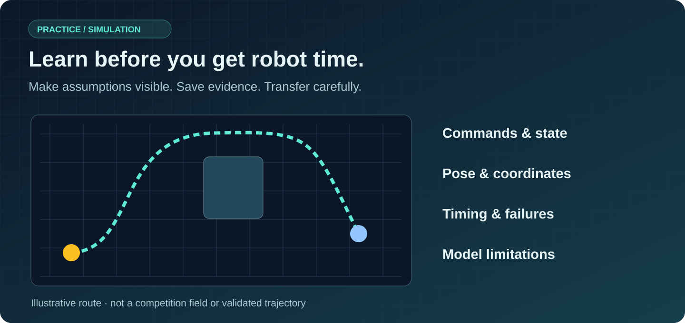

# Autonomous planning

Autonomous routines should be **predictable and measurable** before they become ambitious.

## Build from a reliable baseline

1. List actions in sequence and identify dependencies.
2. Measure starting conditions and tolerances.
3. Implement the simplest useful routine.
4. Repeat the same test enough times to see variation.
5. Record successful runs and failure modes.
6. Add complexity only after the baseline is repeatable.

## Example state sequence





## A useful test log

| Run | Starting condition | Result               | Likely cause / change |
| --- | ------------------ | -------------------- | --------------------- |
| 1   | Baseline           | Record actual result | Record observation    |
| 2   | Repeat             | Record actual result | Compare repeatability |
| 3   | Small perturbation | Record actual result | Check robustness      |

Do not invent success rates. Record real runs and publish methodology alongside performance claims.

Further reading: [WPILib](https://docs.wpilib.org/en/stable/) and [PhotonVision](https://docs.photonvision.org/en/latest/).

## Choose the tool after the failure model

 For FRC, compare [PathPlanner](https://pathplanner.dev/) and [Choreo](https://choreo.autos/). For FTC, use [Road Runner’s current documentation](https://rr.brott.dev/docs/). A planner is not a replacement for state handling, pose validity or timeouts.

**Add to the test:** interrupted sequence, invalid starting pose, timeout, and a failed prerequisite action. Record the expected safe response to each before expanding the route. Use [logs](../tools-workflows/debug-with-logs.md) to compare intent with behavior.

_Editorial review: November 17, 2026._
