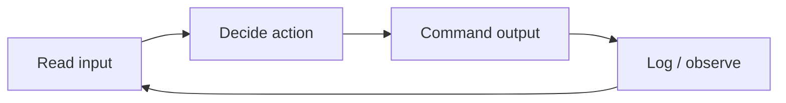

# First robot program

**Goal:** make a small, safe, observable behavior work end to end. Use your program's supported hardware, SDK, and mentor-approved test environment.

## The control loop



Follow the [WPILib Zero to Robot](https://docs.wpilib.org/en/stable/docs/zero-to-robot/introduction.html) course to install the supported toolchain and create a project.

Then trace a simple teleoperated command: which subsystem owns hardware? where is the input read? what limits the output? how do you stop it safely? Work in simulation before moving hardware where possible.



Use the [FTC Docs](https://ftc-docs.firstinspires.org/) setup path for the current SDK and preferred programming environment.

Begin with a supported sample OpMode. Read the hardware configuration and telemetry output before changing actuation behavior. Follow mentor-supervised test procedures.



## Debugging checklist

* Does the project build without errors?
* Are hardware mappings and controller inputs correct?
* Is telemetry present and understandable?
* Is there a predictable stop or disable behavior?
* Can a second person reproduce the test?

**Evidence:** save a screenshot of telemetry, a short test log, and a note describing what changed.


Do not copy old motor-control code onto a live robot without checking current APIs, wiring, motion limits, and the applicable safety requirements.


## Learn from a worked example

### FTC example: starter Blocks programming

Older goBILDA starter lesson. Use it to trace a control flow, then check the current FTC Docs sample and configuration.



[Watch at YouTube](https://www.youtube.com/watch?v=Sjt3rufGoDs) · **Use it:** Identify the hardware names, the control input and the stop behavior. FRC learners should use the WPILib path above.

_Editorial review: November 17, 2026._
