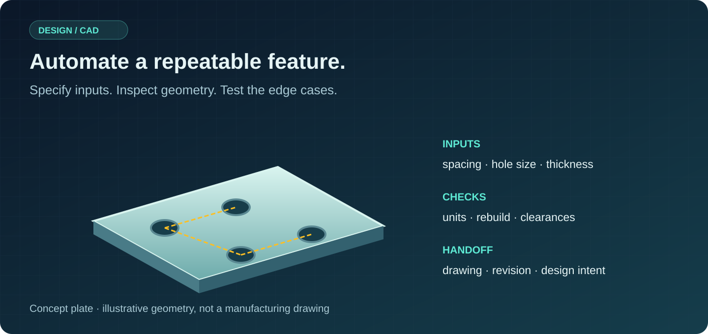

# CAD & mechanical design

<figure><figcaption>
A concept mounting plate. A useful CAD handoff includes inputs, geometric checks and a drawing with design intent.
</figcaption></figure>

## The first course to open

[**FRCDesign learning course**](https://frcdesign.org/learning-course/) is the strongest starting point here for students who want Onshape taught through robotics work. Follow its sequence instead of jumping directly to a complex robot assembly.

Pair it with [Onshape Intro to CAD](https://learn.onshape.com/learning-paths/intro-to-cad) when you need a structured tool introduction. The [Onshape FIRST program hub](https://www.onshape.com/en/education/first-robotics) supplies account and robotics-program context.

### Watch: Onshape — Basic Sketch Geometry

Official English sketching lesson.



[Watch at YouTube](https://www.youtube.com/watch?v=xvn9hD7KMVs) · **Use it:** Explain which degrees of freedom remain in a sketch you made; then dimension it intentionally.

## Resources that prevent avoidable work

<table data-view="cards"><thead><tr><th></th><th></th><th></th></tr></thead><tbody><tr><td><i class="fa-book">:book:</i></td><td><h3><a href="https://www.frcdesign.org/design-handbook/">FRCDesign design handbook</a></h3></td><td>Look up engineering decisions beyond CAD button sequences.</td></tr><tr><td><i class="fa-cubes">:cubes:</i></td><td><h3><a href="https://www.frcdesign.org/learning-course/course-setup/required-course-tools/part-library/">Part-library workflow</a></h3></td><td>Use common FRC components instead of redrawing vendor parts.</td></tr><tr><td><i class="fa-gears">:gears:</i></td><td><h3><a href="https://gm0.org/en/latest/docs/common-mechanisms/">GM0 mechanisms</a></h3></td><td>Compare FTC mechanisms and design tradeoffs.</td></tr><tr><td><i class="fa-graduation-cap">:graduation-cap:</i></td><td><h3><a href="https://www.onshape.com/en/education/student-resources">Onshape student resources</a></h3></td><td>Guided exercises and learning material for independent practice.</td></tr></tbody></table>

## When to introduce automation



Choose [Fusion MCP](../tools-workflows/fusion-mcp.md) for a pilot against a running desktop design. Begin with document inspection and one named parameter change.



Choose [Onshape FeatureScript MCP](../tools-workflows/onshape-mcp.md) for a reusable custom feature. Define inputs and invalid cases before generating code.



**Keep after a CAD session:** the model/version link, one decision record, a manufacturing drawing where needed, and the unanswered fit or load question. A library model is not proof that the ordered part matches the installed revision.

**Practice:** [make a plate](../cad-and-design/first-cad-part.md) · [review it](../cad-and-design/design-review.md) · [test a prototype](../cad-and-design/prototyping.md).

_Last editorial review: November 17, 2026. Follow current publisher documentation for software and season changes._
