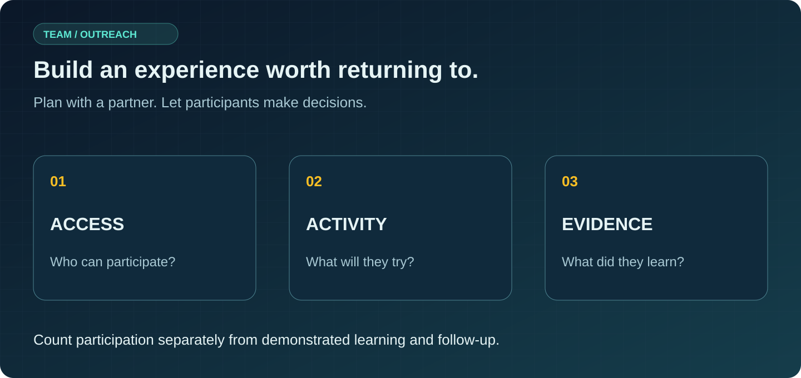

# Outreach, sponsors & grants

<figure><figcaption>
Outreach planning: define access, the activity and evidence of learning. Count attendance separately from outcomes.
</figcaption></figure>

## The sources to open first

<table data-view="cards"><thead><tr><th></th><th></th><th></th></tr></thead><tbody><tr><td><i class="fa-map-pin">:map-pin:</i></td><td><h3><a href="https://www.kyfirstrobotics.org/team-grants">KY FIRST team grants</a></h3></td><td>Kentucky funding opportunities and source-specific restrictions.</td></tr><tr><td><i class="fa-hand-holding-heart">:hand-holding-heart:</i></td><td><h3><a href="https://www.firstinspires.org/resources/library/sponsoring-team-grants">FIRST grant opportunities</a></h3></td><td>National team-grant source pages and guidance.</td></tr><tr><td><i class="fa-file-lines">:file-lines:</i></td><td><h3><a href="https://www.firstinspires.org/resources/library/frc/team-management-resources">FRC team management</a></h3></td><td>Sponsorship templates, team practices and outreach resources.</td></tr><tr><td><i class="fa-users">:users:</i></td><td><h3><a href="https://www.firstinspires.org/resources/library/ftc/team-management-resources">FTC team management</a></h3></td><td>Program-specific management, outreach and team resources.</td></tr></tbody></table>

**Funding pages are directories, not promises of an open application.** Confirm the current deadline, geography, applicant eligibility, allowable expenses and reporting requirements at the source. Keep the source URL and date checked in the team's grant tracker.

### Watch: Inventive Outreach and Your Team

Sarah Heimlich’s Spartan Series talk is linked from FIRST’s FRC team-management library. It is a community teaching example.



[Watch at YouTube](https://www.youtube.com/watch?v=tw8kkre6hK4) · **Use it:** Choose one idea, name the partner it would serve and write what participants should be able to do afterward.

## A stronger outreach brief



Ask what the partner needs before proposing a robot demonstration. Agree on audience, space, supervision, accessibility, materials, and a next step. Make a low-tech alternative for participants who cannot operate the robot or attend the main activity.



Separate attendance, direct participation, demonstrated learning and repeat engagement. Use an appropriate exit question or observation rather than treating every attendee as a long-term STEM outcome. Credit partner contributions and preserve any media permissions.



Tie the ask to a costed need and a truthful outcome: materials for a defined number of sessions, transport for a particular group, or an equipment loan. Ask the team's responsible adult to confirm applicant and financial requirements.



**Use:** [the event planning brief](../team-operations/outreach.md) · [the sponsor and grant checklist](../team-operations/sponsors-and-grants.md) · [Kentucky contacts and program pages](kentucky-teams-season.md).

_Last editorial review: November 17, 2026. Follow current publisher documentation for software and season changes._
