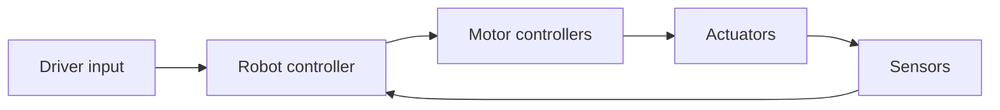
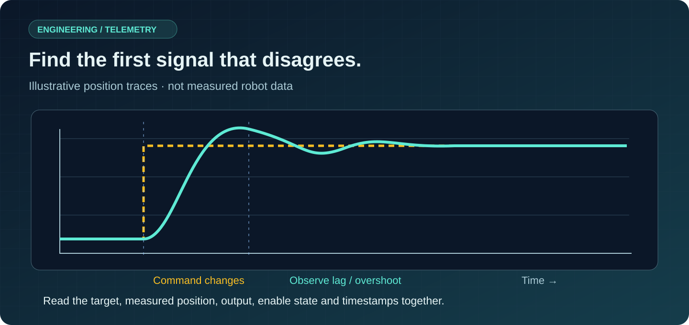

# Robot systems

## External technical references

* [FRC WPILib & robot controls](../resource-library/frc-software-controls.md)
* [FTC hardware and mechanisms](../resource-library/ftc-build-code.md)
* [AdvantageScope, SysId, and diagnostic tools](../tools-workflows/underused-robotics-tools.md)
* [Watch real robot and system demonstrations](../resource-library/watch-and-learn.md)

Use official sources for electrical and safety requirements; use the checklists below to guide your team's own review.

***

Electrical, mechanical, and software systems fail at their interfaces. This section helps teams make those interfaces explicit and test them safely.

## Think in interfaces





The diagram is conceptual; real robot wiring and architecture must follow your program's current rules and vendor instructions.

## Field-ready workflow

| Stage            | Evidence to capture                                           |
| ---------------- | ------------------------------------------------------------- |
| Inspect          | Fasteners, connectors, strain relief, labeling, safe movement |
| Power-on         | Expected status indicators; no unexpected actuation           |
| Basic control    | Inputs map to the right outputs                               |
| Subsystem test   | Each mechanism operates across its expected range             |
| Integration test | Mechanisms do not interfere with each other                   |
| Recovery         | Team knows how to identify and address common faults          |

## Practical guides

* [Electrical inspection](electrical-inspection.md)
* [A troubleshooting playbook](troubleshooting.md)
* [Before-event checklist](before-event.md)


**Safety first.** De-energize hardware before changing connections, secure moving mechanisms, follow manufacturer procedures, and use a trained mentor for work involving batteries, high-current circuits, tools, and energized systems. Follow your program's current safety rules.


Useful references: [FRC official resources](https://www.firstinspires.org/programs/frc/), [WPILib hardware documentation](https://docs.wpilib.org/en/stable/), [REV Robotics documentation](https://docs.revrobotics.com/).

## Start with a traceable question

 For an intermittent fault, use [the telemetry lab](../tools-workflows/debug-with-logs.md). For a repeatable process, save configuration, code commit, conditions and the retest result together.

_Editorial review: November 17, 2026._
