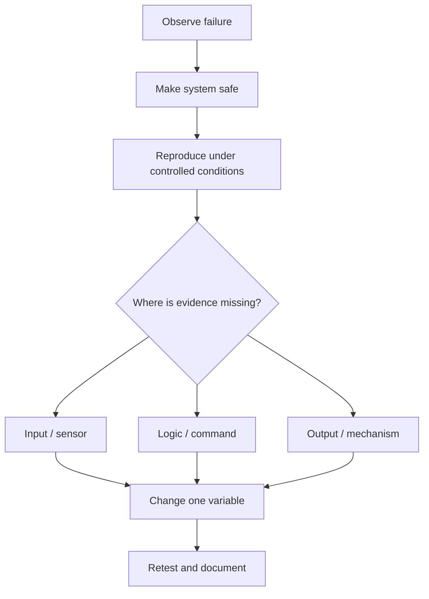

# A troubleshooting playbook

Troubleshooting is an evidence-gathering process, not a contest to guess the cause first.

## Narrow the fault

## Questions to record

* What was expected? What actually happened?
* Is the failure consistent or intermittent?
* What changed since the last known good test?
* What logs, telemetry, measurements, or observations support the hypothesis?
* Can the problem be isolated without energizing unsafe hardware?
* What fixed it, and was the fix retested?


Do not bypass interlocks or safety systems to diagnose a fault. Escalate uncertain electrical or mechanical hazards to a qualified mentor.


## Ticket template

**Symptom:** …

**Steps to reproduce:** …

**Evidence:** …

**Hypothesis:** …

**Action taken:** …

**Retest result:** …

**Owner / follow-up:** …
