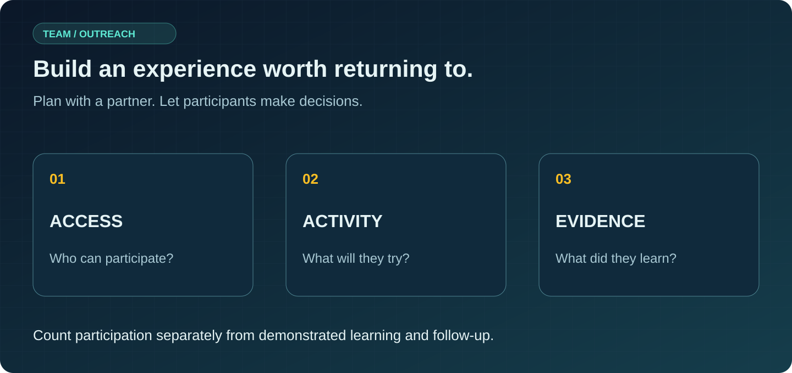

# Team operations

## Existing resources worth using

* [Outreach, sponsors & grants](../resource-library/outreach-sponsors-grants.md) — official FIRST resources, funding directories, Kentucky grants, and an outreach talk.
* [Kentucky teams & season links](../resource-library/kentucky-teams-season.md) — maintained local sources for events and program support.
* [Video learning library](../resource-library/watch-and-learn.md) — outreach and team-management video sources.

The notes below are lightweight planning aids; the linked sources provide the more complete curriculum and official details.

***

Strong teams are built on repeatable habits: clear responsibilities, safe practices, student ownership, funding plans, and relationships that last longer than a season.

## Run the team as a learning environment

| Responsibility     | A useful artifact                                     |
| ------------------ | ----------------------------------------------------- |
| Training           | A short onboarding checklist                          |
| Safety             | Tool access rules and a documented inspection process |
| Knowledge transfer | A design log with photos and decisions                |
| Outreach           | Event briefs, contacts, and follow-up notes           |
| Sponsorship        | A concise proposal and impact report                  |
| Finance            | Budget, approvals, and grant deadlines                |

## Explore

* [Sponsors & grants](sponsors-and-grants.md)
* [Outreach that matters](outreach.md)
* [Team knowledge transfer](knowledge-transfer.md)
* [Safety & inclusion](safety-and-inclusion.md)

## A realistic monthly rhythm



Review current projects, mentor a newer member, and ask what the team has learned that isn't written down. Assign ownership for each open action.



Check supervision and safety boundaries, help remove blockers, and give students room to make and evaluate decisions. Confirm current program compliance.



Follow up with partners, log measurable impact, and store reusable materials in a shared folder. Do not measure success only by event attendance.



## Guiding principle

**Documentation should lower the cost of joining the team.** If a new member cannot understand a process without finding one specific veteran, write it down and improve the process.

## A partner-led outreach workflow

<figure><figcaption>
Outreach planning: access, activity and evidence.
</figcaption></figure>

### Watch: Inventive Outreach and Your Team

A community talk by Sarah Heimlich, linked from FIRST’s management resources.



[Watch at YouTube](https://www.youtube.com/watch?v=tw8kkre6hK4) · **Use it:** Adapt one idea to an actual partner and write the evidence you would collect.

_Editorial review: November 17, 2026._
