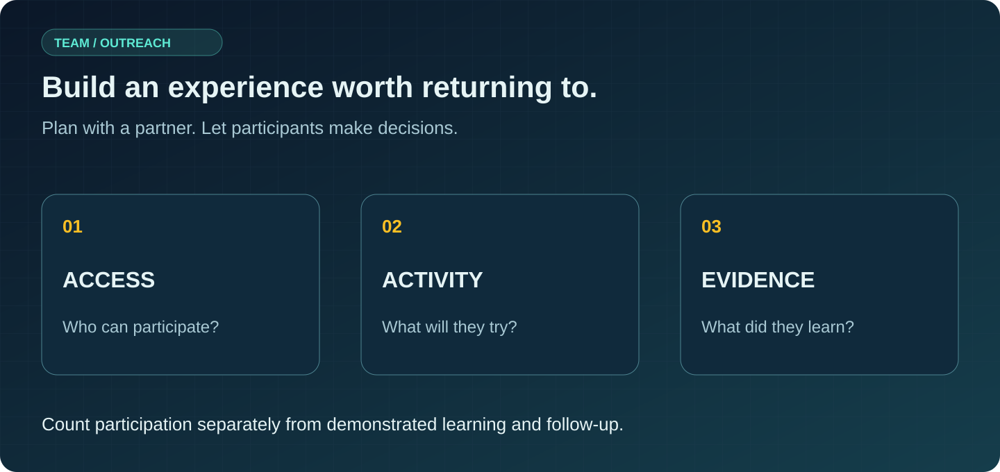

# Outreach that matters

Useful outreach makes robotics more accessible. A successful event is not just a photo opportunity; it creates a meaningful experience for participants.

## Design an event backwards



### Define the audience

Who is coming? What do they already know? What accessibility, supervision, or language needs should you plan for?



### Choose one outcome

Examples: attendees can explain a sensor, try a safe engineering challenge, or learn how to join a local program.



### Build a safe activity

Use clear instructions, supervision, inclusive participation, and any required permissions for photography or media.



### Evaluate

Ask participants what they learned, record attendance where appropriate, and note improvements for the next event.



## Simple activity: paper engineering challenge

Give small groups paper, tape, and a load target. Ask them to build, test, and revise a structure. Compare outcomes and discuss how engineers use constraints.

## Impact report

Record **who participated**, **what they did**, **what changed**, and **what you will do next**. Avoid unsupported impact claims. Credit community partners accurately.

## A useful teaching reference

<figure><figcaption>
Plan access, activity and evidence with a partner before running an outreach event.
</figcaption></figure>

### Inventive Outreach and Your Team

Sarah Heimlich’s Spartan Series presentation is linked from FIRST’s team-management library.



[Watch at YouTube](https://www.youtube.com/watch?v=tw8kkre6hK4) · **Use it:** Write one change you will make to the activity because of a participant or partner need.

_Editorial review: November 17, 2026._
