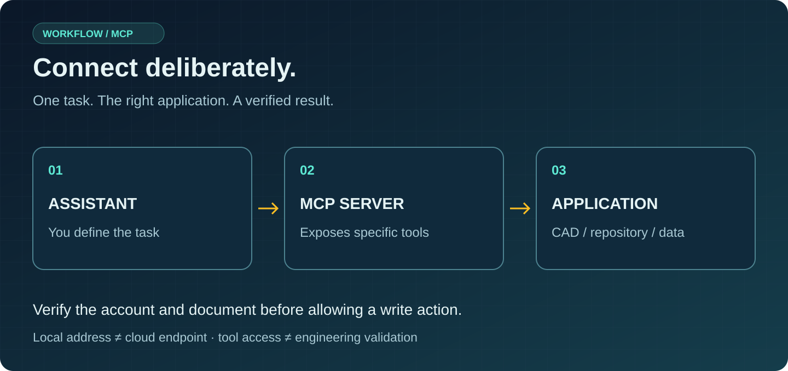

# Tools & workflows

<figure><figcaption>
An assistant connects through a specific MCP server to CAD, a repository or data. Verify the account and document before writing.
</figcaption></figure>

**Pick one bottleneck and run one small pilot.** A tool earns its place when a teammate can explain what improved and reproduce the result.

## Choose a useful experiment

<table data-view="cards"><thead><tr><th></th><th></th><th></th></tr></thead><tbody><tr><td><i class="fa-plug">:plug:</i></td><td><h3><a href="mcp-for-beginners.md">Understand MCP</a></h3></td><td>Learn local versus cloud connections and verify your first tool call.</td></tr><tr><td><i class="fa-cube">:cube:</i></td><td><h3><a href="fusion-mcp.md">Fusion automation</a></h3></td><td>Connect to the active desktop design; compare official and community tools.</td></tr><tr><td><i class="fa-shapes">:shapes:</i></td><td><h3><a href="onshape-mcp.md">Onshape custom features</a></h3></td><td>Create and test one reusable FeatureScript operation.</td></tr><tr><td><i class="fa-terminal">:terminal:</i></td><td><h3><a href="codex-for-robotics.md">Codex for a robot repository</a></h3></td><td>Map a codebase, improve a test, or repair setup instructions.</td></tr><tr><td><i class="fa-chart-line">:chart-line:</i></td><td><h3><a href="debug-with-logs.md">Telemetry and replay</a></h3></td><td>Separate observation from diagnosis with a repeatable log review.</td></tr><tr><td><i class="fa-laptop-code">:laptop-code:</i></td><td><h3><a href="practice-without-robot.md">Practice without hardware</a></h3></td><td>Choose FRC simulation, an FTC Java simulator, or a CAD experiment.</td></tr></tbody></table>

## The adoption check

| Before the pilot                    | Evidence to keep                                |
| ----------------------------------- | ----------------------------------------------- |
| Define a task and owner             | One sentence describing the bottleneck          |
| Use a copy, branch or test document | Baseline version and rollback route             |
| Check tool scope and account        | Which files, documents or services it can reach |
| Run a small experiment              | Result, limitations and next decision           |

[Explore the deeper toolbox](underused-robotics-tools.md) for SysId, coordinate frames, offline scouting, CAD libraries and controls training. Use [the documentation workflow](maintain-team-docs.md) to keep discoveries after students graduate.


AI tools can edit real files and designs. Use a reversible workspace and human review. Test robot software offline before any supervised hardware session. The hub is free to read; linked products can have their own accounts, eligibility requirements or paid plans.


_Last editorial review: November 17, 2026. Follow current publisher documentation for software and season changes._
