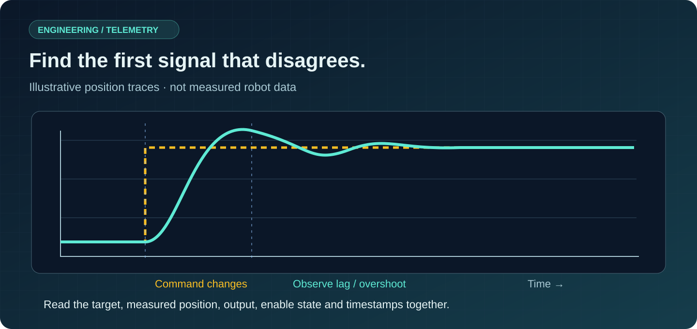

# Debug a robot with logs

<figure><figcaption>
Synthetic target and measured position traces illustrate lag and overshoot. This is not recorded robot performance.
</figcaption></figure>

**Use this when:** a mechanism fails intermittently, a pose jumps, or a routine behaves differently on the field. Start by finding the earliest disagreement between intent, input and output.

## Choose the evidence path



[AdvantageScope](https://docs.advantagescope.org/) reads robot logs and visualizes signals, field poses and robot state. It works without AdvantageKit. Start with [log-file handling](https://docs.advantagescope.org/overview/log-files/) and the [WPILib AdvantageScope guide](https://docs.wpilib.org/en/stable/docs/software/dashboards/advantagescope.html).

If your architecture supports [AdvantageKit replay](https://docs.advantagekit.org/), rerun recorded inputs through code to investigate logic. First establish a baseline replay; changed inputs, unlogged nondeterminism and real-world physics still limit conclusions.



[FTC Dashboard](https://acmerobotics.github.io/ftc-dashboard/) provides telemetry and graphing for compatible FTC projects. Confirm SDK and library compatibility before adding it. Begin with just the signals needed to answer one question.

[AdvantageScope](https://docs.advantagescope.org/) also documents Road Runner log and FTC Dashboard streaming support. Use the maintainer's format and live-source guidance for your installed version.



## Watch: logging as an engineering workflow

### Team 6328 — FRC Data Logging and Visualization

This 2025 Championship workshop is linked from [AdvantageScope’s documentation](https://docs.advantagescope.org/overview/champs-conference/). Use it for the method; consult current docs for the UI.



[Watch at YouTube](https://www.youtube.com/watch?v=ZMxTRgryrvE) · **Use it:** Sketch which inputs, outputs and states your team would need to explain one real failure.

## Lab: explain a missed setpoint



### Preserve context

Save the log, code commit, robot configuration, test conditions and symptom time. Confirm the run is the one you think it is.



### Align a small set of signals

Plot target position, measured position and requested actuator output. Add enable state, command/subsystem state and timestamps. Label units. Start before the symptom, not just at the visible failure.



### Find the first disagreement

Did the target change? Did code request output? Did the measured state respond? A saturated request with no motion is a different investigation from a command that never scheduled.



### Test one hypothesis

Write a claim that a controlled follow-up can disprove. Save the evidence before and after a change. Offline replay can probe code; a supervised physical test is needed for physical behavior.



Read the illustrative chart

The dashed target steps upward; the measured trace follows later, rises above the target, then settles. That shape suggests questions about delay and overshoot. It does not identify a root cause. Inspect commanded output, sensor units, timestamps and test context before attributing it to tuning. The chart is synthetic teaching data.

### Diagnose the evidence, not the picture

| Observation                            | Useful next check                                         |
| -------------------------------------- | --------------------------------------------------------- |
| Requested action never appears         | Scheduler/OpMode state, trigger conditions, enable state  |
| Output requested but sensor stays flat | Sensor validity, units, mechanism and electrical evidence |
| Position jumps instantly               | Timestamp alignment, estimator reset, coordinate frame    |
| Live display disagrees with a log      | Data source, sampling, filtering and matching run         |

**Deliverable:** an annotated timeline, one falsifiable hypothesis, one controlled retest, and a known limitation. Avoid changing multiple tuning values at once.

**Next:** [practice with simulation](practice-without-robot.md) · [SysId and deeper tooling](underused-robotics-tools.md).

_Last editorial review: November 17, 2026. Follow current publisher documentation for software and season changes._
