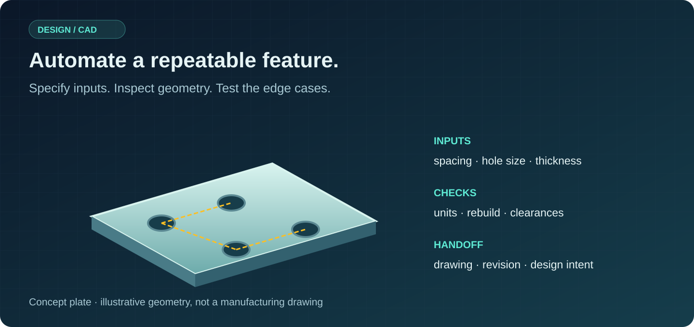

# Fusion MCP: local CAD assistant

<figure><figcaption><p>Concept mounting plate. Define spacing, hole size and thickness; inspect units, regeneration and clearances before handoff.</p></figcaption></figure>

**Use this when:** you repeatedly inspect or edit parameters in an Autodesk Fusion desktop design. Start with Autodesk's built-in server; add community tooling only for a capability the official connection does not expose.

## Connect the official local server



### Prepare a test design

Launch current Fusion desktop and save a disposable copy. The local server needs Fusion running on the machine your client can reach.



### Enable the server and copy its address

Open **Preferences → General → API**, enable **Fusion MCP Server**, and copy the endpoint shown there. Autodesk documents `http://127.0.0.1:27182/mcp` as the default. Your displayed port takes precedence.



### Configure your client



In **Settings → Cursor Settings → Tools & MCPs**, add this entry to the MCP configuration:


```json
{
  "mcpServers": {
    "fusion": { "url": "http://127.0.0.1:27182/mcp" }
  }
}
```




Use the `fusion_mcpb.mcpb` bundle from the release linked in [Autodesk's integration repository](https://github.com/Autodesk/ai-integrations/blob/main/fusion/local-mcp-server/README.md). Supply the port shown in Fusion when prompted.



Codex accepts HTTP MCP servers. With Fusion open, add the local endpoint:


```bash
codex mcp add fusion --url http://127.0.0.1:27182/mcp
codex mcp list
```


This combines Autodesk's endpoint with [Codex's documented HTTP connection syntax](https://learn.chatgpt.com/docs/extend/mcp?surface=cli). It is a configuration example, not a hardware-tested certification. Run the client on the same host; a cloud session or WSL environment has a different meaning of `127.0.0.1`.





### Verify the target before changing it

Ask: “Identify the active document, units and available inspection tools. Do not change geometry.” Compare the response to Fusion. If it is wrong, stop and fix the connection.



Connection details: [Autodesk integration README](https://github.com/Autodesk/ai-integrations/blob/main/fusion/local-mcp-server/README.md) and [Fusion MCP help](https://help.autodesk.com/view/fusion360/ENU/?guid=FMCP-OVERVIEW).

## A first pilot: a family of mounting plates

Give the assistant one precise job:

> In this test copy, inspect the existing named parameters. Propose a change to the hole spacing parameter from its current value to 30 mm. Explain which features depend on it. Wait for review before applying. After the edit, report regeneration errors and resulting dimensions. Do not export or overwrite the production design.

**Accept the pilot only if:** the parameter exists, units are explicit, the pattern regenerates, all intended hole locations change, and a designer verifies edge distance and fit. The 30 mm value is an exercise input, not a robot standard.

## Local modeling, cloud data, and extra tools



Works with the running Fusion design. Best first experiment for geometry inspection and modeling. Query the actual available tools before promising an operation.



Autodesk's separate cloud-data connection targets authorized project/file data. It does not replace the live desktop modeling server. Use the [official overview](https://help.autodesk.com/view/fusion360/ENU/?guid=FMCP-OVERVIEW) to choose the relevant service.



[faust-machines/fusion360-mcp-server](https://github.com/faust-machines/fusion360-mcp-server) documents a separate add-in plus Python/stdio bridge, with modeling, inspection and export tools. [Poyraxx/fusion-advanced-mcp-server](https://github.com/Poyraxx/fusion-advanced-mcp-server) documents modeling and Electronics workflows, exports, and arbitrary API execution. These are **third-party projects**, with different installation paths and trust requirements.

Do not point their launcher at Autodesk's port: they are different implementations. Pin a reviewed revision, inspect the tool list and installation instructions, and try one disposable document. Keep local services on loopback; broad code-execution tools deserve explicit review.



<details>

<summary>Connection troubleshooting</summary>

* **No tools:** check Fusion is running and MCP is enabled.
* **Connection fails:** compare the complete endpoint, port, `/mcp` path and transport with the publisher's instructions.
* **Wrong model:** verify the active document and component context before writes.
* **Browser URL shows an error:** a normal browser request is not an MCP protocol handshake. Use the client's connection status and tool discovery.
* **Persistent handshake errors:** record Fusion/client versions and use [Autodesk's troubleshooting page](https://help.autodesk.com/cloudhelp/ENU/ADSKMCP-FusionDesktopMcp/files/ADSKMCP_FusionDesktopMcp_troubleshooting_html.html). Do not disable security controls to force a connection.

</details>

**Next:** [Compare Onshape FeatureScript MCP](onshape-mcp.md) or [review the design evidence](../cad-and-design/design-review.md).

_Last editorial review: November 17, 2026. Follow current publisher documentation for software and season changes._
