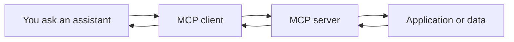

# MCPs for beginners

An **MCP server** (Model Context Protocol) is a connector that describes tools and data an AI assistant can use. The assistant asks a server to perform actions; the server interacts with a real application, repository, or service. MCP is not a new model and doesn't automatically grant access to every file.

## What changes when you connect a tool?

Without a connection, an assistant can suggest CAD steps. With an appropriate **CAD MCP**, it may be able to inspect and change an actual model in an authorized session.

## Three practical types

| Type                       | Example                                                                                                               | What it does                                                       |
| -------------------------- | --------------------------------------------------------------------------------------------------------------------- | ------------------------------------------------------------------ |
| **Local desktop**          | [Autodesk Fusion local MCP](https://help.autodesk.com/view/fusion360/ENU/?guid=FMCP-OVERVIEW)                         | Accesses a running app on your computer                            |
| **Cloud service**          | [Fusion Data MCP](https://www.autodesk.com/products/fusion-360/blog/introducing-the-autodesk-fusion-data-mcp-server/) | Accesses authorized cloud projects, folders, or items              |
| **Code / developer tools** | [Codex MCP support](https://learn.chatgpt.com/docs/extend/mcp)                                                        | Adds documentation, services, or developer tools to a coding agent |

## A setup pattern that works for most MCPs



### Identify the exact job

For example: “Inspect the active Fusion document” or “read my project's issue list.” Don't install connectors simply because they exist.



### Choose a trustworthy server

Prefer first-party vendor documentation. For third-party servers, inspect the repository, permissions, maintenance, and how credentials are stored.



### Connect an MCP-compatible client

For a local server, enable or run the server and enter its URL or launcher command in the client. For cloud MCPs, follow the service's sign-in flow.



### Verify read-only first

Ask the client to list the available tools or retrieve one harmless piece of information. Confirm it reached the right account, session, and document.



### Make one reversible change

Save or branch your work, request a small action, inspect the result, and undo it if necessary. Expand permissions only when justified.



## Common failure modes

The underlying app may be closed, the server disabled, or the client pointed at a different port. For Fusion, check **Preferences → General → API** and verify that the desktop app is running.

Check whether the server expects OAuth or a local connection. Don't paste access tokens into a public GitHub issue or shared prompt.

The service may expose read-only tools, or permissions may be restricted by its account, client, plan, or workspace role.


MCP tools can perform real operations. Treat requests to execute code, edit project files, or change CAD as potentially destructive. Read the permissions and preserve backups.


**Try next:** [Fusion MCP](fusion-mcp.md), [Onshape FeatureScript MCP](onshape-mcp.md), or [Codex for robotics code](codex-for-robotics.md).
