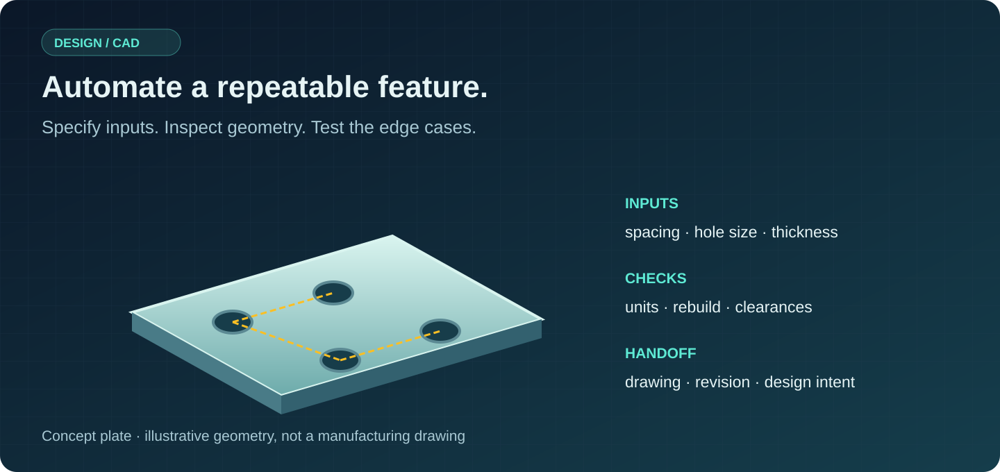

# Onshape FeatureScript MCP

**Use this when:** your CAD team repeats the same modeling operation across many parts. Onshape's official MCP focuses on **FeatureScript authoring and testing**, rather than unrestricted natural-language operation of every CAD command.

## Connection recipe



### Enable the official app

Sign in to Onshape and find **FeatureScript MCP Server** in the [Onshape App Store](https://cad.onshape.com/appstore). Follow the subscription and application-settings steps in [Onshape's setup guide](https://www.onshape.com/en/blog/get-started-featurescript-mcp-server). It is an Onshape Labs service; check current access and pricing before adopting it. No purchase is required to use this hub.



### Add the documented endpoint

Onshape's [Claude Code connection guide](https://www.onshape.com/en/resource-center/tech-tips/connect-featurescript-mcp-server-claude-code) uses:


```bash
claude mcp add --transport http onshape https://fs-mcp.labs.onshape.app/mcp
```


Launch Claude Code and follow the documented authorization and `/mcp` authentication flow. If using another client, use its HTTP/OAuth instructions; do not paste a Claude command into another client's settings.



### Prove the connection

Create a disposable Onshape document. Ask the assistant to create a Feature Studio named `FS1` in **that document URL**, then verify it appears. Authorize only the intended Onshape account.



## A useful robotics pilot: a rectangular mounting pattern

<figure><figcaption><p>A concept mounting plate with four holes. Geometry is illustrative and must be checked against real manufacturing requirements.</p></figcaption></figure>

Define the feature before asking for code:

> Create a custom feature for a planar face that cuts a two-by-two mounting pattern. Inputs: center, X spacing, Y spacing, hole diameter. Use explicit units. Reject zero or negative dimensions and explain invalid selections. Start in the test document. Show the FeatureScript and any errors before iterating.

These are suggested requirements, not guaranteed server behavior. A CAD lead reviews selection logic, geometry and FeatureScript before reusing it.

| Test                             | Evidence to inspect                                            |
| -------------------------------- | -------------------------------------------------------------- |
| Nominal plate                    | Four correctly located holes, dimensions match inputs          |
| Different spacing and face       | Feature follows the selected face and new inputs               |
| Too-small plate                  | Team-defined boundary behavior is clear; no silent invalid cut |
| Zero diameter or wrong selection | Clear validation message or a documented limitation            |
| Upstream geometry changes        | Rebuild succeeds or fails understandably                       |

**Keep:** document/version link, input examples, limitations, and the test matrix. A feature that works once is not yet a team standard.

<details>

<summary>Where this workflow stops</summary>

FeatureScript MCP can help write and iterate custom features. It does not certify loads, fastener sizing, tolerances or competition legality. Community Onshape MCP projects can have entirely different capabilities. Check the tool list rather than assuming every “Onshape MCP” is the same service.

</details>

**If access is unavailable:** learn [FeatureScript directly](https://cad.onshape.com/FsDoc/) and prototype the feature manually; the design and test work still transfers.

**Next:** [Fusion desktop MCP](fusion-mcp.md) · [CAD courses and libraries](../resource-library/cad-mechanical-design.md).

_Last editorial review: November 17, 2026. Follow current publisher documentation for software and season changes._
