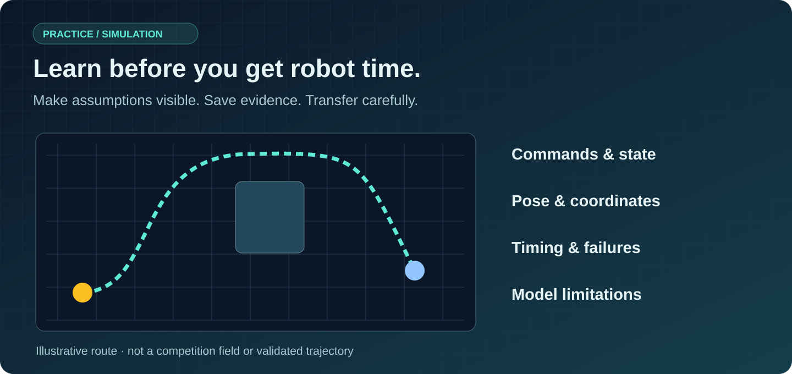

# Practice without a robot

<figure><figcaption>
Illustrative simulated route around an obstacle. Test commands, pose, timing and the limitations of the model.
</figcaption></figure>

## Choose your environment



Use [WPILib Robot Simulation](https://docs.wpilib.org/en/stable/docs/software/wpilib-tools/robot-simulation/introduction.html) to run code without a roboRIO. Start with a supported example and meaningful simulated sensor behavior. A dashboard moving on screen is not evidence that the physics model is accurate.

**Pilot:** test command transitions with a normal completion, timeout and interrupted action. Log state and timestamps. Keep a reproducible launch procedure.



[Beta 8397 virtual\_robot](https://github.com/Beta8397/virtual_robot) is a community 2D simulator for learning FTC-style Java programming. Follow its own setup instructions and supported environment. Use [FTC Docs](https://ftc-docs.firstinspires.org/en/latest/) for the real SDK workflow.

**Pilot:** drive a virtual route with an explicit initial pose, then change the start condition. Record which assumptions the program makes. Do not assume virtual device behavior exactly matches your robot.



Use [FRCDesign](https://frcdesign.org/learning-course/) or [Onshape Learning Center](https://learn.onshape.com/) to make a part and have a teammate review its drawing. Use [GitHub Skills](https://skills.github.com/) for branch and review practice.

**Pilot:** a new member follows your setup notes independently and proposes one correction. This tests the team's onboarding process as well as the learner.



## Trajectory planning is a separate layer

[Choreo](https://choreo.autos/) provides dynamics-constrained FRC trajectory planning; [PathPlanner](https://pathplanner.dev/) supports its own path and autonomous workflow. Choose an integration your team can maintain. A generated trajectory, simulated controller and physical robot are three different things to validate.

| Question                                    | What to save                                                                   |
| ------------------------------------------- | ------------------------------------------------------------------------------ |
| Does the routine select the right actions?  | State/command trace                                                            |
| Does the simulated model follow the target? | Target versus measured pose                                                    |
| Are robot parameters plausible?             | Dimensions, mass/inertia assumptions, limits and units                         |
| What remains unmodeled?                     | Traction, latency, battery behavior and mechanism effects relevant to the test |

## Finish with a handoff

Keep the code commit, tool versions, initial conditions and one expected result. Name the first supervised hardware test you would run later. If a teammate cannot reproduce the experiment, simplify it before expanding it.

**Next:** [review the resulting logs](debug-with-logs.md) · [plan a robust autonomous routine](../programming/autonomous-planning.md).

_Last editorial review: November 17, 2026. Follow current publisher documentation for software and season changes._
